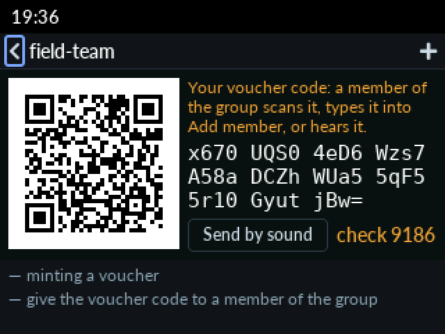

# pigeonhole_reticulous

Apps for [Reticulous](https://github.com/reticulous) devices that use the Pigeonhole protocols: a
device is a client of a Pigeonhole replica on a Reticulum mesh, does the BACAP encryption itself,
and reads and writes boxes through the replica, so it shares groups with clients on the
Katzenpost mixnet through a bridge replica.

  
  

The Group Chat app at the T-Deck's 320×240: a group with kate, and joining a group with a
voucher code, which a phone can also scan. The screens are drawn by `esp-idf/test/lcd-sim`,
which builds the app's screens on the desktop with the device's LVGL, fonts and text entry, and
runs the real chat client behind them.

Licensed under the GNU Affero General Public License, version 3 only (AGPL-3.0-only).
`esp-idf/components/kq_qrcode` holds Nayuki's QR Code generator, under the MIT License.
